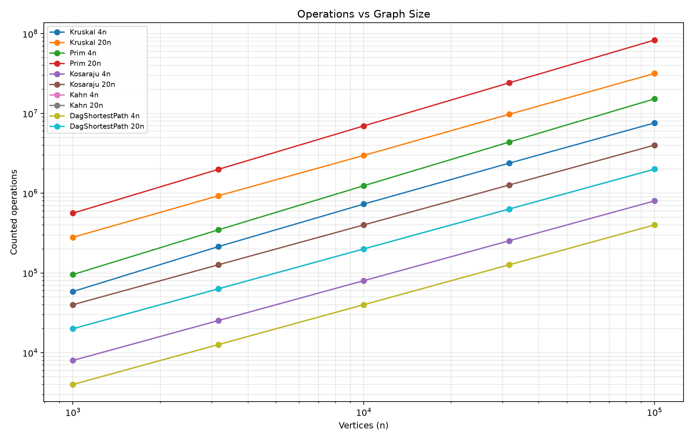
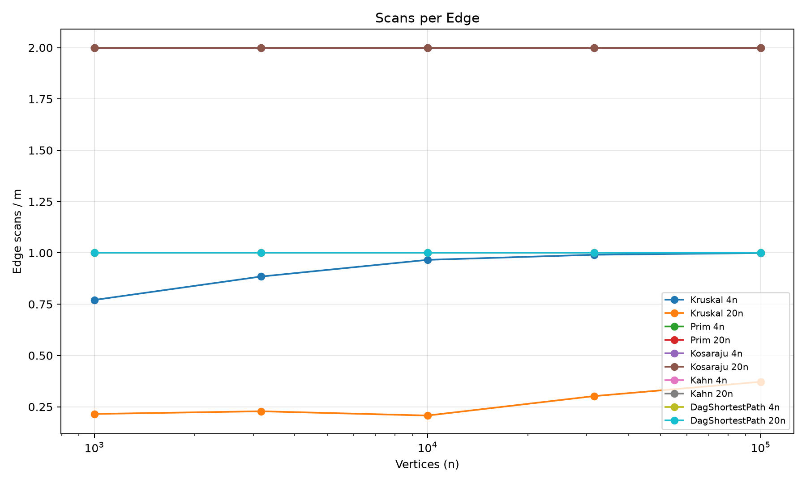
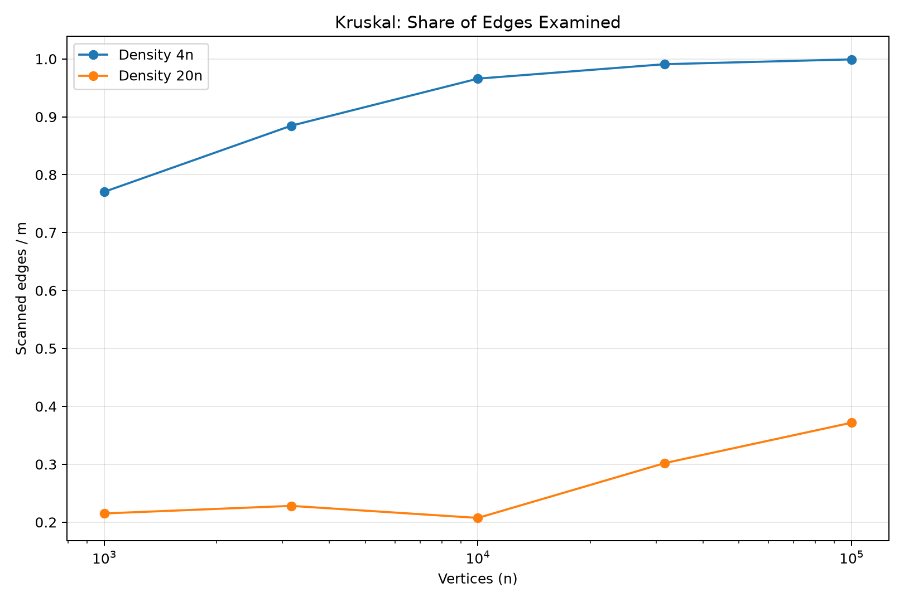

# Assignment 3 — Graph Algorithms: Analysis Report

**Student:** Iskander Shaymerdenov  
**Course:** Design and Analysis of Algorithms  
**University:** Astana IT University  
**Project:** City Network & Job Scheduler

## 1. Introduction

The goal of this assignment is to implement and analyze graph algorithms using Java. The project includes Disjoint Set Union (DSU), Kruskal's and Prim's minimum spanning tree algorithms, Kosaraju's strongly connected components algorithm, Kahn's topological sorting algorithm, and shortest paths in a directed acyclic graph (DAG).

The project uses adjacency lists for graph representation and JUnit 5 for testing. The algorithms count operations to evaluate their computational complexity independently of hardware performance.

## 2. Complexity Analysis

| Algorithm | Time Complexity | Extra Space | Explanation |
|---|---|---|---|
| DSU find/union | O(α(V)) amortized | O(V) | Path compression and union by size reduce the cost of operations. |
| Kruskal | O(E log E) | O(V + E) | Sorting edges dominates the running time. DSU prevents cycles. |
| Prim | O(E log V) | O(V + E) | A priority queue selects minimum-weight candidate edges. |
| Kosaraju | O(V + E) | O(V + E) | Two DFS passes explore the graph and its transpose. |
| Kahn | O(V + E) | O(V) | Each vertex is processed once and every edge is examined once. |
| DAG Shortest Paths | O(V + E) | O(V) | Topological sorting is followed by one relaxation pass. |

## 3. Correctness of Minimum Spanning Tree Algorithms

Kruskal's and Prim's algorithms are based on the cut property of minimum spanning trees. The cut property states that a minimum-weight edge crossing a cut is safe to add to an MST. Kruskal sorts edges in increasing order of weight and adds an edge only if it connects two different components. DSU helps detect whether adding an edge would create a cycle. Prim starts at a vertex and repeatedly selects a minimum-weight edge connecting the current tree to an unvisited vertex. Both algorithms therefore make safe choices that can be extended to a minimum spanning tree. On disconnected graphs, both algorithms construct a minimum spanning forest.

## 4. Correctness of DAG Shortest Paths

A directed acyclic graph has a valid topological ordering of its vertices. In this ordering, every edge goes from an earlier vertex to a later vertex. All vertices with zero in-degree are initialized with distance zero, representing a virtual super-source. When a vertex is processed, all incoming edges have already been considered. Therefore, its shortest distance is final before its outgoing edges are relaxed. By induction over the topological order, every vertex receives the correct shortest distance. Negative edge weights are allowed because the graph contains no directed cycles, so repeated relaxation around a negative cycle is impossible.

## 5. Benchmark Methodology

The benchmark evaluates five graph sizes: 1,000; 3,162; 10,000; 31,623; and 100,000 vertices.

For each size, two densities are used: sparse graphs with E = 4V and dense graphs with E = 20V.

Three graph types are generated: undirected graphs for MST, directed graphs for SCC, and DAGs for topological sorting and shortest paths.

Each algorithm is measured five times, and the median execution time is reported. Operation counters provide more reproducible evidence than execution times.

The benchmark uses a fixed random seed of 42. Correctness is checked by comparing Kruskal and Prim, validating topological ordering, and checking expected reference values.

## 6. Operation Counters vs Complexity

Operation counters are collected directly inside the algorithms.

Kosaraju performs two DFS passes and scans exactly 2E edges. Kahn scans E edges, and DAG shortest-path relaxation also scans E edges.

As the graph size increases, these scan counts remain proportional to the number of edges. The ratios edgeScans/E are 2 for Kosaraju and 1 for Kahn and DAG relaxation.

Kruskal has additional sorting comparisons, explaining its O(E log E) time complexity. Prim performs priority-queue comparisons while selecting candidate edges. DSU uses path compression and union by size, making its operations almost constant in amortized time.

## 7. Choosing the Right Algorithm

| Situation | Recommended Algorithm | Reason |
|---|---|---|
| Weighted undirected graph, edge-list representation | Kruskal | Sorting edges and using DSU is straightforward. |
| Weighted undirected graph, adjacency-list representation | Prim | Grows the tree using nearby candidate edges. |
| Detect strongly connected components | Kosaraju | Identifies groups of mutually reachable vertices. |
| Schedule dependent tasks | Kahn | Produces a topological order and detects cycles. |
| Shortest paths in a DAG | DAG Shortest Paths | Runs in linear time and supports negative weights. |
| Repeated component merging | DSU | Efficient union and connectivity queries. |

For sparse graphs, Kruskal is often a convenient choice because relatively few edges need sorting. Prim is useful with adjacency lists and a priority queue. The best practical choice depends on graph representation, density, and implementation costs.

## 8. Plots and Experimental Analysis

### Plot 1 — Operations vs Graph Size

The log-log graph shows how counted operations increase with the number of vertices. Linear graph traversals grow proportionally to E, while MST algorithms include additional sorting or priority-queue work.

### Plot 2 — Scans per Edge

The plot illustrates the ratio between edge scans and total edge count. Constant ratios confirm the expected linear edge-traversal behavior.

### Plot 3 — Kruskal Edge Examination

The graph compares the proportion of edges examined by Kruskal on sparse and dense graphs. Kruskal can terminate early when its minimum spanning tree has been completed.

## 9. Execution Time Discussion

Execution time depends on hardware, JVM optimization, memory management, and other background processes. Small benchmark cases are particularly affected by measurement noise. The five-run median reduces some variability, but execution time alone is not sufficient to confirm theoretical complexity.

Operation counts are more reliable because they describe algorithmic work rather than machine performance.

## 10. Conclusion

This project demonstrates how different graph algorithms solve different problems. Kruskal and Prim construct minimum spanning forests, Kosaraju identifies strongly connected components, Kahn finds a valid task order, and DAG shortest paths calculates minimum path costs.

The use of operation counters, automated tests, and deterministic graph generation supports reproducible analysis. Choosing an appropriate algorithm depends on graph structure, direction, density, and the problem being solved.